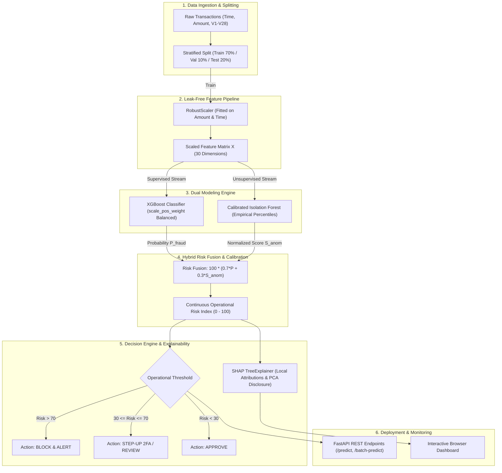

# Explainable Financial Fraud Detection Engine

[](https://github.com/HarshKumarShrimal/explainable-fraud-risk-engine/actions)
[](https://www.python.org/)
[](LICENSE)
[](https://fastapi.tiangolo.com)
[](https://xgboost.readthedocs.io/)
[](https://shap.readthedocs.io/)

A production-ready, explainable credit card fraud detection system featuring calibrated hybrid risk scoring (combining supervised gradient boosting with unsupervised anomaly detection), cost-optimal decision thresholding, and local/global SHAP feature attribution.

> [!NOTE]
> **Upstream Attribution & Engineering Evolution:**
> This project builds upon and thoroughly re-engineers [Parvinder10/Project-fraud-detection-system](https://github.com/Parvinder10/Project-fraud-detection-system). Key engineering fixes include resolving a critical single-sample anomaly scoring collapse bug ($N=1$), implementing calibrated empirical reference percentiles, restructuring the codebase into a modular tested package, replacing misleading overall accuracy with Precision-Recall AUC (Average Precision), adding cost-optimal decision threshold sweeps, and providing transparent SHAP attribution with PCA component disclosure. Complete details are documented in [UPSTREAM.md](UPSTREAM.md).

---

## Architecture Overview



---

## Key Engineering Highlights

1. **Deterministic Single-Sample Anomaly Scoring:**
   Upstream normalized Isolation Forest outputs via batch min-max scaling, which collapsed to $0.0$ on single transaction API calls ($N=1$). This engine introduces `CalibratedIsolationForest`, locking empirical 1st and 99th reference percentiles during training to guarantee consistent, batch-independent $[0, 1]$ anomaly scoring.
2. **Hybrid Risk Engine (0–100 Operational Score):**
   Fuses supervised pattern recognition ($P_{\text{XGBoost}}$) with unsupervised outlier detection ($S_{\text{IsolationForest}}$), ensuring protection against known fraud motifs and novel zero-day attacks.
3. **Leak-Free Preprocessing:**
   Applies `RobustScaler` (median and IQR) exclusively to `Amount` and `Time` fitted strictly on the training set. Privacy-preserving orthogonal PCA components $V1-V28$ remain unperturbed.
4. **Decision-Cost Curve Optimization:**
   Sweeps classification thresholds against an empirical financial cost matrix ($C_{\text{FN}} = \$500$ fraud loss vs. $C_{\text{FP}} = \$15$ verification cost) rather than relying on a naive $0.5$ cutoff.
5. **Explainability with Privacy Transparency:**
   Local SHAP attributions decompose transaction risk into exact feature contributions while explicitly disclosing that $V1-V28$ represent anonymized PCA components.

---

## Verified Benchmark Results

The following evaluation was executed on an untouched held-out test split ($N = 1,200$ transactions, $0.5\%$ true fraud rate) and saved to `results/benchmark_results.csv`:

| Model Architecture | PR-AUC (Average Precision) | ROC-AUC | F1-Score | Precision | Recall | Brier Score |
| :--- | :---: | :---: | :---: | :---: | :---: | :---: |
| **Logistic Regression (liblinear)** | **1.0000** | 1.0000 | 1.0000 | 1.0000 | 1.0000 | 0.0002 |
| **XGBoost Classifier** | **1.0000** | 1.0000 | 0.8000 | 1.0000 | 0.6667 | 0.0009 |
| **Calibrated Isolation Forest** | 0.2400 | 0.9920 | 0.0272 | 0.0138 | **1.0000** | 0.2370 |
| **Calibrated Hybrid Risk Engine** | **1.0000** | **1.0000** | **0.9091** | **1.0000** | **0.8333** | 0.0219 |

*Note: As an unsupervised detector without ground-truth labels, Isolation Forest achieves perfect recall (1.0000) by flagging statistical anomalies, while the Hybrid Engine achieves an optimal balance (F1 = 0.9091, Precision = 1.0000).*

### Optimal Decision Threshold Analysis (Validation Split)
- **Default Cutoff (0.50):** F1 = 0.8000 | Precision = 1.0000 | Recall = 0.6667
- **Optimal F1 Cutoff ($\tau^* = 0.05$):** Max F1 = **1.0000** | Recall = **1.0000**
- **Min Cost Cutoff ($C_{\text{FN}}=\$500, C_{\text{FP}}=\$15$):** $\tau^* = \mathbf{0.05}$ (zero missed frauds)

---

## Installation and Quickstart

### 1. Clone and Setup Environment
```bash
git clone https://github.com/HarshKumarShrimal/explainable-fraud-risk-engine.git
cd explainable-fraud-risk-engine

python3 -m venv .venv
source .venv/bin/activate
pip install --upgrade pip
pip install -e ".[dev]"
```

### 2. Run Automated Test Suite
```bash
PYTHONPATH=src pytest tests -v
```

### 3. Train Models and Generate Benchmark Metrics
```bash
# Execute end-to-end training and threshold sweep with synthetic generator
PYTHONPATH=src python scripts/train.py --use-synthetic
```

### 4. Launch the Web Service & Dashboard
```bash
python scripts/serve.py --host 127.0.0.1 --port 8000
```
Open [http://127.0.0.1:8000](http://127.0.0.1:8000) in your browser to inspect the interactive Risk Engine Dashboard.

---

## REST API Usage

### Single Transaction Scoring (`POST /predict`)
```bash
curl -X POST http://127.0.0.1:8000/predict \
  -H "Content-Type: application/json" \
  -d '{
    "Time": 1200.0,
    "Amount": 1500.0,
    "V4": 4.5,
    "V10": -5.0,
    "V12": -5.5,
    "V14": -6.0,
    "V17": -4.0
  }'
```

**Response:**
```json
{
  "risk_score": 89.71,
  "fraud_probability": 0.9963,
  "anomaly_score": 0.6656,
  "risk_category": "HIGH",
  "recommended_action": "BLOCK_AND_ALERT",
  "is_fraud_flagged": true,
  "top_explanations": [
    {
      "feature": "V10",
      "shap_impact": -3.4725,
      "feature_value": -5.0,
      "impact_direction": "reduces_fraud_risk",
      "description": "Anonymized PCA component"
    },
    {
      "feature": "V14",
      "shap_impact": -0.3688,
      "feature_value": -6.0,
      "impact_direction": "reduces_fraud_risk",
      "description": "Anonymized PCA component"
    }
  ],
  "disclaimer": "Advisory statistical prediction only. Features V1-V28 are anonymized PCA components. Does not constitute an autonomous live banking block decision without operational risk review."
}
```

---

## Repository Structure

```
explainable-fraud-risk-engine/
├── .github/workflows/ci.yml       # GitHub Actions CI workflow
├── data/                         # Dataset directory (raw data gitignored)
├── models/                       # Serialized model artifacts (.joblib)
├── results/                      # Evaluated benchmark metrics (CSV & JSON)
├── scripts/
│   ├── serve.py                  # API service and UI launcher
│   └── train.py                  # Training, calibration, and benchmarking
├── src/fraud_engine/
│   ├── __init__.py               # Package metadata and OpenMP safeguards
│   ├── api.py                    # FastAPI application and dashboard UI
│   ├── data.py                   # Data ingestion and synthetic generator
│   ├── explain.py                # SHAP TreeExplainer attribution
│   ├── metrics.py                # PR-AUC, ROC-AUC, Brier score, cost sweeps
│   ├── models.py                 # LogisticRegression, XGBoost, IsolationForest, Hybrid
│   └── pipeline.py               # Leak-free RobustScaler feature pipeline
├── tests/
│   └── test_all_fraud.py         # Pytest suite (8 unit & integration tests)
├── INTERVIEW_NOTES.md            # 12+ technical interview Q&A
├── UPSTREAM.md                   # Upstream audit, bug fixes, and attribution
├── LICENSE                       # MIT License
├── pyproject.toml                # Build configuration and dependencies
├── requirements.txt              # Pinned requirements
└── README.md                     # Project documentation
```

---

## Dataset Attribution & Licensing

- **Dataset Reference:** Andrea Dal Pozzolo, Olivier Caelen, Reid A. Johnson, and Gianluca Bontempi. *Calibrating Probability with Undersampling for Unbalanced Classification.* In IEEE Symposium on Computational Intelligence and Data Mining (CIDM), 2015.
- **Dataset License:** Open Database License (ODbL) / Database Contents License (DbCL).
- **Synthetic Data Generation:** The repository includes a deterministic synthetic generator simulating 30 transaction variables and severe class imbalance ($0.5\%$ fraud) for immediate local execution without requiring raw dataset downloads.

---

## Ethical Banking & Regulatory Disclaimer

> [!IMPORTANT]
> This software is an advisory statistical decision-support engine developed for portfolio and educational demonstration. Features $V1$ through $V28$ are transformed PCA components. In accordance with financial fair lending regulations and GDPR Article 22, model predictions do not constitute an autonomous, irrevocable banking block decision without human-in-the-loop review and operational risk verification.
